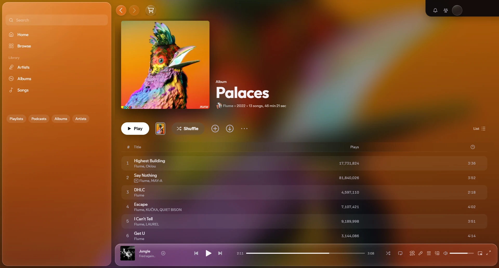
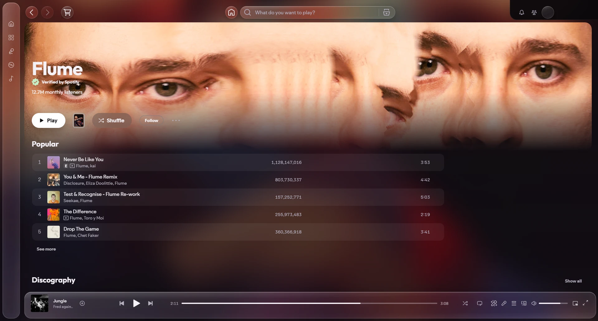
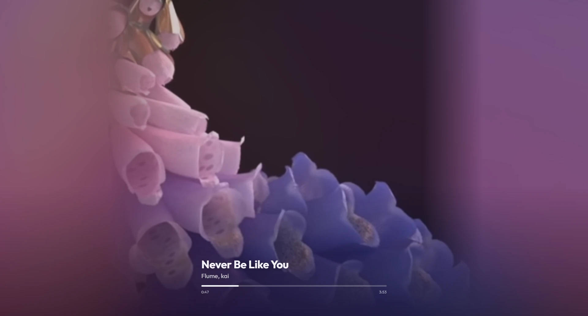

# Lushy for Spotify

**[What it is](#what-it-is)** · **[What it looks like](#what-it-looks-like)** · **[How to install](#how-to-install)** · **[How to remove](#how-to-remove)** · **[Good to know](#good-to-know)**

## What it is

A theme that gives the Spotify app on Windows a new look. The album, playlist or artist you open
fills the background, blurred, behind frosted-glass panels. The colours follow the song that's
playing, and full screen is cinematic.

It's still Spotify underneath, so everything works as before.

## What it looks like

**An album.** Its cover fills the background.

**An artist.** Their photo fades into the page as you scroll.

**Full screen.** Click the cover art in the player bar.

## How to install

1. Download this page as a ZIP: the green **Code** button, then **Download ZIP**. Unzip it.
2. Double-click **Install Lushy theme.cmd**.
3. If you don't have [Spicetify](https://spicetify.app) (the free tool Lushy runs on), it offers to
   install it. Say yes. Spicetify then asks whether you want its Marketplace too: say yes if you'd
   like lyrics in full screen.
4. Spotify restarts with the theme.

**Lyrics in full screen (optional):** install **Spicy Lyrics** from the Spicetify Marketplace (the
cart button at the top of Spotify). Full screen then shows its word-by-word lyrics.

## How to remove

Double-click **Restore normal Spotify.cmd**.

## Good to know

- When Spotify updates itself, the theme goes away. Run **Install Lushy theme.cmd** again to bring
  it back.
- For a darker background, click your profile picture (top right), then **Lushy background** →
  **Dark**.
- Needs Windows and the Spotify app from spotify.com (not the Microsoft Store one).
- Spotify doesn't support Spicetify, and its terms don't allow modifying the app. Lots of people use
  Spicetify, but use it knowing that.

How Lushy works, and how to work on it: [docs/DEVELOPING.md](docs/DEVELOPING.md).

## Licence

MIT (see `LICENSE`). The Outfit typeface is by the Outfit Project Authors, under the SIL Open Font
License 1.1 (`Lushy/OFL-Outfit.txt`).
